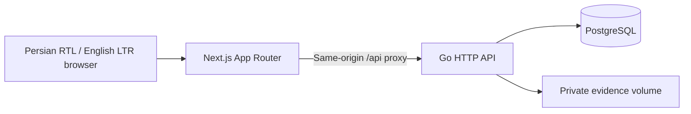

# Architecture

## Repository layout

- `web/src/app`: Next.js layout, route validation and global visual system.
- `web/src/components`: application shell, dashboard, operational views, typed forms, detail workspaces and accessible native dialogs.
- `web/src/lib`: API boundary, locale/time helpers, and shared TypeScript resource types.
- `backend/cmd/api`: startup, environment configuration and graceful shutdown.
- `backend/internal/app`: HTTP routes, session authentication, permissions, scoped workspace reads and operational mutations.
- `backend/internal/database`: transactional schema initialization and opt-in sample data.
- `scripts`: Windows development helpers; local state is ignored under `.local`.

## Relational model

Customers own brands; brands own products. Campaigns reference a matching brand and product. Shifts connect a campaign, location, supervisor, execution time and target. Assignments connect staff to shifts. Attendance, stock movements, reports, evidence and issues all reference a shift. Audit events record actor, action, affected entity and server time. Sessions store only a SHA-256 digest of an opaque random token.

The stock balance is `initial + added - distributed - damaged - returned`. It is derived rather than manually overwritten. Mutations acquire the shift row lock before reading or writing the ledger. Business records and their audit entries commit together. Schema initialization is serialized with a PostgreSQL advisory transaction lock.

## API

| Method | Route | Purpose |
| --- | --- | --- |
| GET | `/health` | API and database readiness |
| GET | `/api/config` | Whether the development demo is enabled |
| POST | `/api/auth/login`, `/api/auth/logout` | Start/end a session |
| POST | `/api/auth/demo` | Development-only demo role session |
| GET | `/api/auth/me` | Current authenticated person |
| GET | `/api/workspace` | Scoped typed resources and trend data |
| POST | `/api/campaigns`, `/api/locations`, `/api/shifts` | Create a plan |
| PATCH | `/api/campaigns/{id}` | Change campaign status |
| POST | `/api/shifts/{id}/assignments` | Assign a sampler |
| POST | `/api/shifts/{id}/readiness` | Supervisor readiness confirmation |
| POST | `/api/shifts/{id}/check-in`, `/check-out` | GPS attendance |
| POST | `/api/shifts/{id}/stock` | Append a validated stock movement |
| POST | `/api/shifts/{id}/evidence` | Multipart photo upload |
| GET | `/api/evidence/{id}` | Serve an authorized evidence image |
| POST | `/api/shifts/{id}/report` | Submit or resubmit a report |
| POST | `/api/reports/{id}/review` | Approve or return a report |
| POST/PATCH | `/api/issues`, `/api/issues/{id}` | Create or update an issue |
| POST | `/api/people`, `/api/catalog` | Maintain staff and base data |
| GET | `/api/reports/export?days=30&city=...` | Scoped UTF-8 CSV |

JSON writes use `Content-Type: application/json` and `X-Requested-With: FaraCode`; photo uploads use multipart with the same request header. Errors use `{ "error": "readable message" }`. SQL parameters carry all user-supplied values. The API does not enable cross-origin access; Next.js exposes it through the same-origin proxy.

## UI behavior

The default document is Persian RTL. Workspace settings persist language locally. The UI fetches authenticated data, refreshes after every successful mutation and every minute while the page is visible, and displays explicit pending/error states. It does not silently emulate backend success. Browser geolocation supplies measured coordinates and accuracy. Local fonts avoid external font dependencies.

Shift inputs use Asia/Tehran, matching display formatting and backend campaign-day checks. Unauthorized API responses clear the workspace and retain sign-out across reloads; session revisions prevent stale reads from restoring signed-out data. A committed write and its subsequent refresh have separate outcomes: a failed read produces a persistent refresh notice without treating the write as failed. Evidence upload follows the same mutation path.

See [platform verification](platform-verification.md) for the database-backed regression suite and browser harness. Demo startup includes narrowly scoped, idempotent repairs for inconsistent original sample report/attendance records, with an audit entry. User-created records are retained.

## Deployment details

The Next.js production bundle uses standalone output. `API_URL` is embedded into rewrite destinations at build time, so rebuild the frontend if the backend address changes. Docker Compose builds with `http://api:8080`, keeps the API/database private, and publishes only the frontend to loopback. `APP_ENV=production` disables demo login and sets secure cookies. Use TLS at the reverse proxy, provision the first administrator through environment variables, and back up the evidence volume with the database.

Application-level security controls are implemented; production capacity, durable backup/restore, operational monitoring, dependency updates and the business acceptance pilot remain deployment responsibilities.
